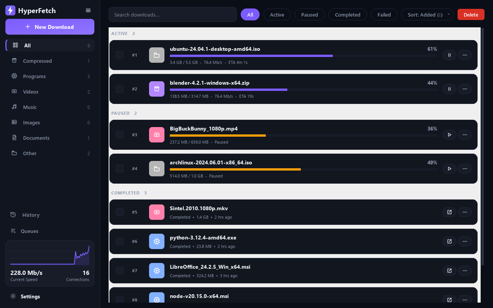

# HyperFetch

**Fetch everything. Download faster.**

A fast, multi-connection download manager for Windows. It splits each file
across many connections, grabs streaming video and torrents, and pairs with a
browser extension that sends your downloads straight to the app.

**Website:** https://tanumay-deb.github.io/HyperFetch/ · **Download:** [latest release](https://github.com/tanumay-deb/HyperFetch/releases/latest)

**Nothing to install:** [HyperFetch on the web](https://hyperfetch-dl.duckdns.org/) takes a link, a magnet or a torrent from any browser, a phone's included.



## Features

- **Download large files much faster** — splits each file across up to 16 connections at once (auto-detects support; falls back to a single stream otherwise).
- **Never lose progress** — pause and resume anytime, even across restarts; resume picks up from the bytes already on disk. Keep unfinished downloads in a folder of your choice; each moves to its own folder when it finishes. Organize downloads into named queues with their own limits; they start in the order of their number.
- **Save streaming video** — capture HLS (`.m3u8`) streams as one playable file (optionally rewritten as an ordinary MP4, so players can skip around in it), and download from YouTube, Vimeo, Twitch and more with a quality picker.
- **Torrents & magnets** — built in, no separate app needed. Pick which files to fetch, a whole folder at a time, and see how far each has got. A torrent that stalls is tried again by itself, the same torrent is never added twice (as a magnet, a `.torrent` file or a link), and the list sorts by seeds or peers.
- **Grab downloads from your browser** — right-click a link, click the badge on a video, or auto-capture downloads by file type. The extension for Chrome, Edge and Firefox hands them to the app.
- **Updates itself** — checks GitHub once a day, downloads the new version, checks it against the SHA-256 GitHub lists, and asks before installing.
- **Track everything** — every completed download is logged with lifetime totals and stats.
- **Privacy & control** — speed limits, a global proxy, encrypted DNS lookups (DNS-over-HTTPS), a local relay that gets past a provider's site block, UPnP, optional SHA-256 checks, and keeping the PC awake while downloading.

## Install

**Windows (most people — no Python needed):** download **`HyperFetch-<version>-setup.exe`**
from the [Releases](https://github.com/tanumay-deb/HyperFetch/releases) page and
run it. The installer bundles its own Python runtime, `aria2c` and `ffmpeg`, so it
works on a clean machine, and from then on the app updates itself
(**Update to …** in the sidebar; Settings → General). (Unsigned, so Windows SmartScreen shows *"Windows protected your
PC"* on first run → **More info → Run anyway**.) Prefer no install? Grab the
`-portable.zip`, extract it, and run `HyperFetch.exe` inside the folder.

**Developers / other OS (needs Python 3.10+):**

```powershell
pipx install git+https://github.com/tanumay-deb/HyperFetch.git
hyperfetch
```

(No `pipx`? `pip install git+https://github.com/tanumay-deb/HyperFetch.git`, then run `hyperfetch`.)

The window opens and a local server starts at `http://127.0.0.1:21456`.

### From source

```powershell
pip install -r requirements.txt
python main.py          # or double-click HyperFetch.bat
python api_server.py    # headless: queue downloads with no window
```

## Browser extension

1. **Install it** for your browser:
   [Chrome Web Store](https://chromewebstore.google.com/detail/hyperfetch/finojjembpabfbincabngboedegokdlm) (also Brave),
   [Firefox Add-ons](https://addons.mozilla.org/addon/hyperfetch/) or
   [Edge Add-ons](https://microsoftedge.microsoft.com/addons/detail/ebgbghogfnompbkhihmaohhdehkdkcjj).
2. Start the app. Chrome and Edge pair with it on their own; Firefox asks once in the app, showing a code to match. If neither happens, open **Settings → Browser Integration**, copy the pairing token, and paste it into the extension popup.
3. Keep the app running. Right-click a link → **Download with HyperFetch**, or turn on capture to route browser downloads automatically (pick which file types in Settings).

<details><summary>Run the unpacked extension from source (development)</summary>

1. Open `chrome://extensions` (or `edge://extensions`) and enable **Developer mode**.
2. **Load unpacked** → select the `chrome_ext/` folder.

</details>

## Users site

There is a separate build, **HyperFetch Server**, that serves a multi-user
site: accounts, per-user storage quotas, retention, an invite code and an
audit trail. It is not part of this repository and not part of the desktop
app — a download manager is not a hosting service, and keeping them apart is
how you avoid publishing a machine you did not mean to.

The desktop app has a **web client** instead: one page, your own network,
one password, off by default — see [Web client](#web-client).

## Web client

Use the app from another browser or your phone (**Settings → Web Client**):

1. Turn on **Enable web client** and set a username and password.
2. On this PC, open `http://127.0.0.1:21456/ui/`. For your phone, also turn on
   **Allow access from my network** (it then needs a password of at least 8
   characters) and open the same page at this PC's address.

It shares nothing with the browser extension: the extension pairs with a token,
the web client signs in with its own password.

## How it works

| Part | Role |
|------|------|
| `downloader.py` | segmented HTTP downloader (ranges, retry/backoff, merge) |
| `torrent.py` / `hls.py` / `yt_dl.py` | torrent, HLS, and media-page engines |
| `queue_manager.py` | priority queue, concurrency, scheduler |
| `history.py` | completed-download log + stats |
| `api_server.py` | local Flask server the extension talks to |
| `gui2/` | the desktop GUI |
| `web/` | the web client's page |
| `chrome_ext/` · `edge_ext/` · `firefox_ext/` | the browser extension (kept in sync) |

The GUI and the server share **one** queue, so browser-sent and manually-added
downloads land in the same list. Everything runs on your machine — no accounts,
no tracking. Settings and state live in `%APPDATA%\HyperFetch\`.

## Tests

```powershell
pip install -r requirements-dev.txt
pytest                                  # Python suite (offline; the real-engine tests need aria2c and ffmpeg)
cd chrome_ext/test && npm install && npm test   # extension tests
```

## Build (Windows)

```powershell
.\build.ps1             # -> dist\HyperFetch\ (portable app)
.\build.ps1 -Installer  # also builds the setup.exe (needs Inno Setup 6)
```

## License

MIT — see [LICENSE](LICENSE). Privacy policy: [PRIVACY.md](PRIVACY.md). Please
download only content you have the right to.

## Code signing policy

Free code signing provided by SignPath.io, certificate by SignPath Foundation.

The application was made on 6 October 2026 and is waiting for an answer.
Releases up to and including 2.8.4 are not signed; the first signed release
will say so in its notes.

- **What is signed:** `HyperFetch.exe` and the installer, built by GitHub
  Actions from the tagged source in this repository
  ([`.github/workflows/release.yml`](.github/workflows/release.yml)). The
  bundled `aria2c` and `ffmpeg` are other projects' binaries and are not.
- **Committers and reviewers:** [Tanumay Goswami](https://github.com/tanumay-deb)
- **Approvers:** [Tanumay Goswami](https://github.com/tanumay-deb)
- **Privacy policy:** https://tanumay-deb.github.io/HyperFetch/privacy.html

